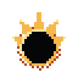
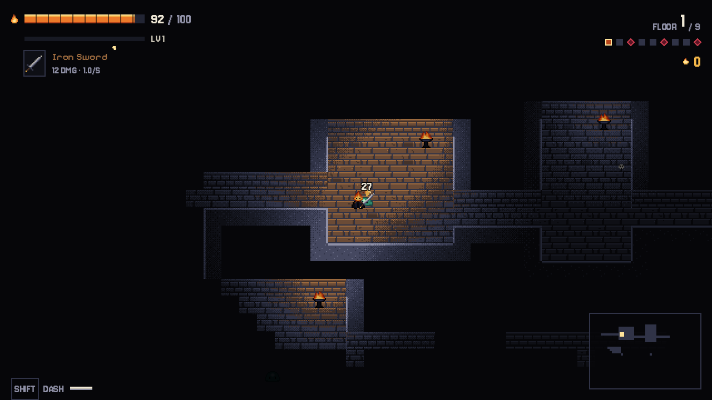
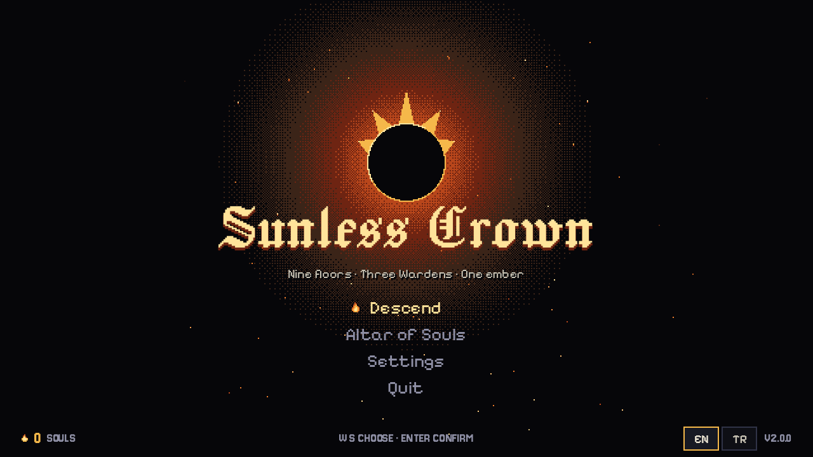
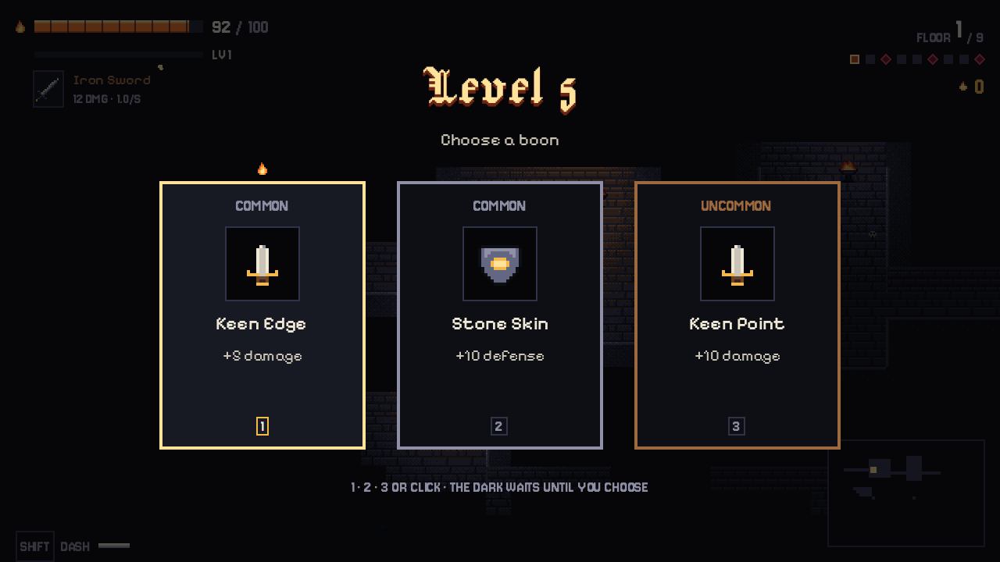
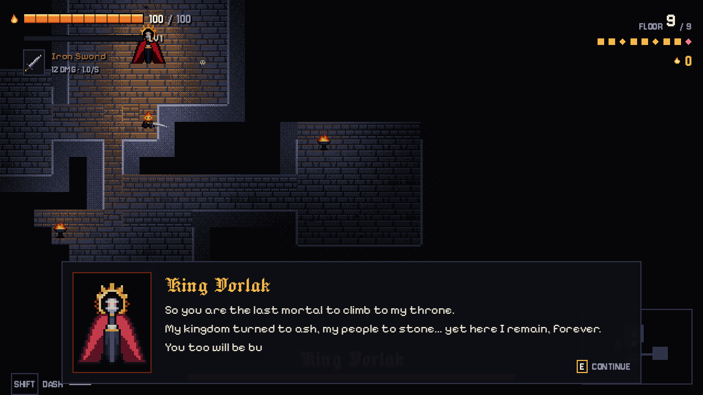
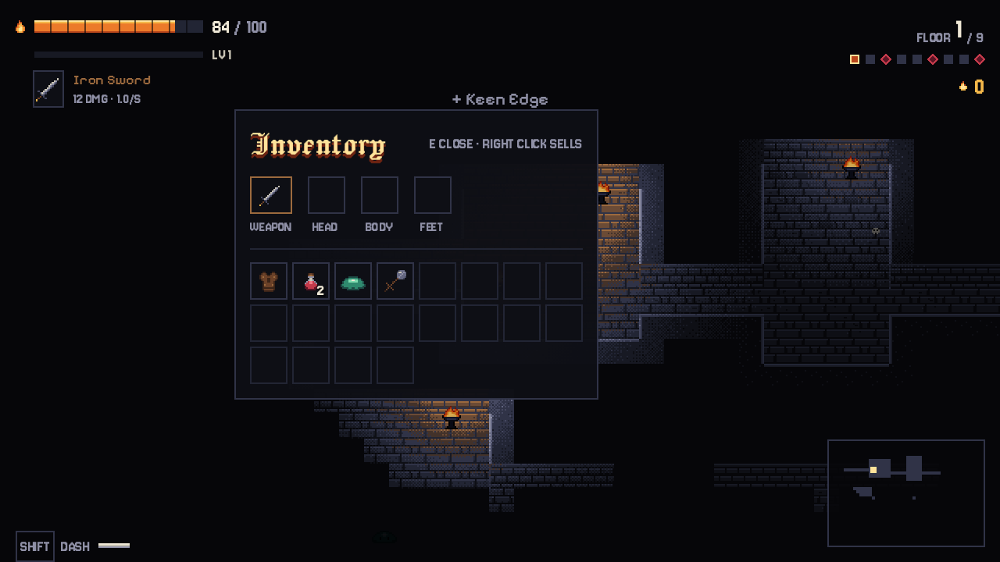
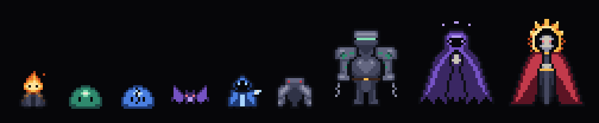
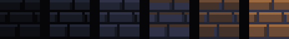

<p align="center">
  
</p>

<h1 align="center">Sunless Crown</h1>

<p align="center">
  A top-down roguelite made in Godot 4.7. Nine floors, three Wardens, one ember.<br>
  <a href="https://crown.aslanlabs.online"><b>Play in the browser</b></a> · <a href="../../releases/latest">Windows build</a> · English and Türkçe
</p>

<p align="center">
  
</p>

The kingdom's sun went out the day its king put on the Sunless Crown. You are the last ember: a small knight with a flame for a head, and the only warm light in the game. Go down through nine floors built from a seed, take a boon every time you level up, and break the curse the three Wardens guard.

## What's in it

- **Procedural floors.** Rooms and corridors from a seed, with a flood-fill check that every room can be reached. The stairs down open once the floor is clear.
- **Combat.** Mouse aim, a dash with invulnerability frames, knockback, hit-stop, screen shake and damage numbers.
- **Six enemies,** each driven by a small state machine: slimes, slimes that split, bats, frost mages that keep their distance, and brutes.
- **Three Wardens** on floors 3, 6 and 9. Each has two phases, telegraphed slams, volleys, summons and their own lines before and after the fight.
- **Loot and builds.** Weapons and armor in five rarities, 22 boons in three, potions, and an Altar where the souls from every run buy boons that stay.
- **English and Turkish,** switchable on the title screen or the pause menu. Keyboard, mouse and gamepad.

<table>
  <tr>
    <td></td>
    <td></td>
  </tr>
  <tr>
    <td></td>
    <td></td>
  </tr>
</table>

## Design: Ember in the dark

<p align="center">
  
</p>

**Only the ember is warm.** Orange and gold always mean fire: the player, braziers, souls, the sword's trail. Red means danger. Everything else is cold stone.

**Light shifts the palette instead of tinting it.** Tiles store a shade (0 to 3) instead of a colour. A shader adds the light level at each pixel (0 to 5, with ordered dithering between levels) and reads the colour from a single stone ramp. Stone goes from near-black blue in the dark to warm brown next to the flame without ever leaving the palette. `LightManager` packs the nearest light sources into a small texture every frame.

<p align="center">
  
</p>

**The dark hides; eyes give it away.** Floors you have not walked are black. Outside the light, enemies are silhouettes and only their eyes and spells glow.

**One palette, drawn in code.** The game uses 32 colours. Every sprite, tile and icon is a grid of characters in [`tools/art`](tools/art), and `build.py` renders them to PNG. That includes the mark, the three Wardens and every item icon.

<p align="center">
  
</p>

The type is Jacquard 24 for titles and Warden names, Pixelify Sans for the interface and dialogue, and Jersey 10 for numbers.

## Controls

| Action | Keys |
| --- | --- |
| Move | WASD or arrow keys |
| Aim | Mouse |
| Attack | Left click, F or Enter |
| Dash | Shift |
| Interact | Q |
| Inventory | E (right click an item to turn it into souls) |
| Pause | Esc |
| Fullscreen | F11 |

A gamepad works too: d-pad to move, A to attack, B to dash, X to interact, Y for the inventory, Start to pause.

## Run it from source

1. Install [Godot 4.7](https://godotengine.org) (the standard build).
2. Open `project.godot` and press F5.

The art is regenerated with `python tools/art/build.py` (needs Pillow). The translation table comes from `python tools/i18n_build.py`, which writes `i18n/strings.csv`. `export_presets.cfg` has a Web preset (no threads, so no special headers) and a Windows preset.

## How it is built

```
autoload/    EventBus · GameManager · RunManager · SaveManager · AudioManager · Juice · LightManager · Settings
components/  Health · Hitbox · Hurtbox · Stats · Inventory · Equipment · ShakeCamera · LightSource
resources/   ItemData · WeaponData · EnemyData · BossData · UpgradeData · LootTable
systems/     DungeonGenerator: rooms, corridors, connectivity
scenes/      player · enemies · items · props · world · fx · ui (built in code on one UI kit)
assets/      shaders (the light model) · sprites · tilesets · fonts · audio
data/        enemies · bosses · items · upgrades · loot tables (.tres)
tools/       art kit · translation table · screenshot runner
```

Data lives in `Resource` files, systems talk through signals on `EventBus`, and reusable behaviour sits in components.

## Credits

- Engine: [Godot](https://godotengine.org) (MIT).
- Fonts: Jacquard 24, Pixelify Sans and Jersey 10, all under the SIL Open Font License. The licence texts are in [`assets/fonts`](assets/fonts).
- Art: drawn for this game in `tools/art`, under the same licence as the code.

Details are in [THIRD-PARTY.md](THIRD-PARTY.md).

## License

The code and art are MIT, see [LICENSE](LICENSE). Fonts and audio by others keep their own licences.

## Türkçe

Güneşsiz Taç, Godot 4.7 ile yapılmış, yukarıdan bakışlı bir roguelite. Krallığın güneşi, kral Güneşsiz Taç'ı taktığı gün söndü. Sen son közsün: kafası alevden küçük bir şövalye ve oyundaki tek sıcak ışık. Dokuz kata in, her seviyede bir lütuf seç ve üç Muhafız'ın koruduğu laneti kır.

Oyun Türkçe ve İngilizce oynanabiliyor; dil başlık ekranından ya da duraklatma menüsünden değişiyor. [Tarayıcıda oyna](https://crown.aslanlabs.online).
